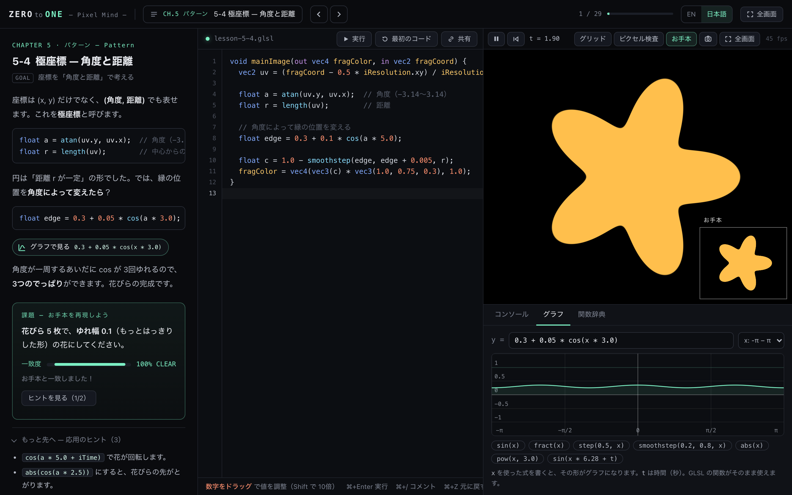

# ZERO to ONE — Pixel Mind —

**ピクセルの気持ちになって学ぶ、GLSL シェーダー入門。**
ブラウザだけで動く、無料のインタラクティブな GLSL 教材です。エンジニアではなく、初心者のために作りました。

**[▶ アプリを開く（日本語）](https://hugesesame.github.io/zero-to-one-glsl/?lang=ja)** · [English README](README.md)

## なぜ作ったか

GLSL の教材の多くはエンジニア向けです。Processing を少し触ったことがある程度だと、最初の数ページで置いていかれがちです。

ZERO to ONE は、シェーダーがわかるようになるいちばん大事な考え方——**すべてのピクセルが、同時に、自分の色を決めている**——から始めて、小さな一歩ずつ積み上げていきます。誰も置き去りにしません。

名前の由来は、シェーダーの考え方そのものです。色も座標も、ほとんどすべてを **0.0 から 1.0** で考えます。

## 特徴

- **全 8 章・29 レッスン**。1レッスンで新しく出てくることは1つだけ
- **ライブコーディング**：書き換えると、すぐに映像に反映
- **コード中の数字をドラッグ**して値を変えられる（Processing の Tweak モードと同じ感覚）
- **自動判定の課題**：お手本の映像と比べて、一致度を ％ で表示
- **エラーをやさしい言葉で解説**：原因と直し方、「もしかして」の候補つき
- **段階的なヒント**（最後に答え）
- **ピクセル検査**：プレビューにマウスを乗せると、そのピクセルの座標と色の値が見える
- **グラフ**：`sin`・`step`・`smoothstep`・`fract` など、好きな式の形をその場で描く
- **関数辞典**、座標グリッド、全画面プレビュー、PNG 保存
- **キーボード操作**：`,` / `.` または `←` / `→` で前後のレッスンへ、`Space` で一時停止、`Cmd/Ctrl+Enter` で実行、`?` でヘルプ
- 随所に「**Processing では / GLSL では**」の比較
- **Shadertoy 互換**の書き方（`mainImage`・`iTime`・`iResolution`・`iMouse`）。TouchDesigner の GLSL TOP 用への書き出しにも対応
- **ヘルプ**：選んでいる言語で使い方ガイドを表示（`?` キーまたはヘルプボタン）
- **English / 日本語** をいつでも切り替え
- 進捗とコードはブラウザに保存。アカウント登録・インストール・トラッキングなし

## カリキュラム

| 章 | 内容 |
| --- | --- |
| 0 · はじめに | シェーダーの描き方、エラーの読み方 |
| 1 · 色 | `vec4`、`1` と `1.0` の違い（型）、`mix` |
| 2 · 座標 | `fragCoord`、`uv`、原点の移動、`if` |
| 3 · 形 | `step`、`smoothstep`、円、アスペクト比、形の組み合わせ、距離関数（SDF） |
| 4 · 動き | `iTime`、波と波紋、マウス、`fract` でリズム |
| 5 · パターン | 繰り返し、タイルの番号、回転、極座標 |
| 6 · 色と質感 | コサインパレット、乱数、ノイズ、fBm |
| 7 · 応用 | レイマーチングで 3D、作例つきの自由制作 |

## ローカルで使う

アプリ全体がファイル1枚です。外部ライブラリもビルドも不要です。

1. [`index.html`](index.html) をダウンロード
2. ブラウザで開く

**WebGL2** に対応したブラウザ（最新の Chrome / Edge / Firefox / Safari）が必要です。

## クレジット

- コサインパレットや距離関数の多くのテクニックは、[Inigo Quilez](https://iquilezles.org/) 氏の記事を参考にしています。
- レッスンの流れは [The Book of Shaders](https://thebookofshaders.com/) と [Shadertoy](https://www.shadertoy.com/) のコミュニティから着想を得ています。

## ライセンス

[MIT](LICENSE) © 2026 hugesesame
