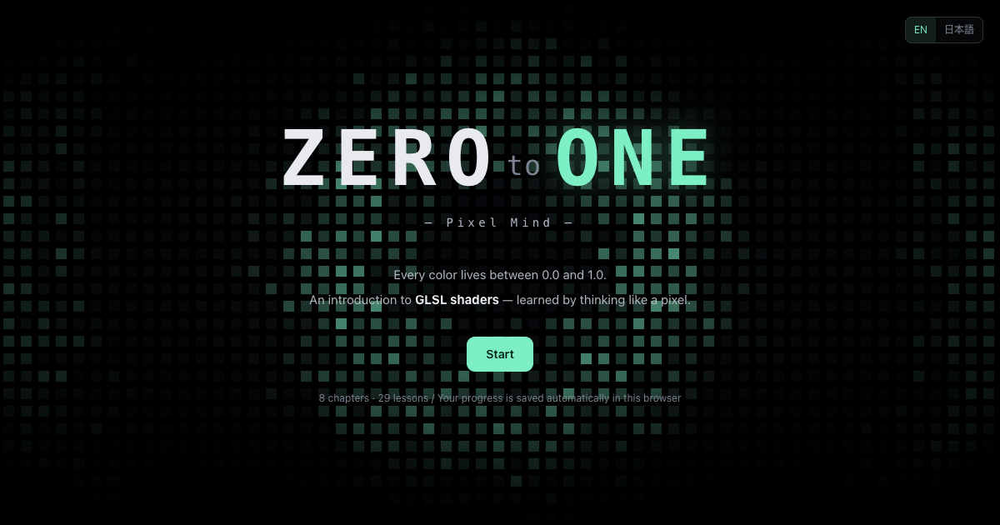
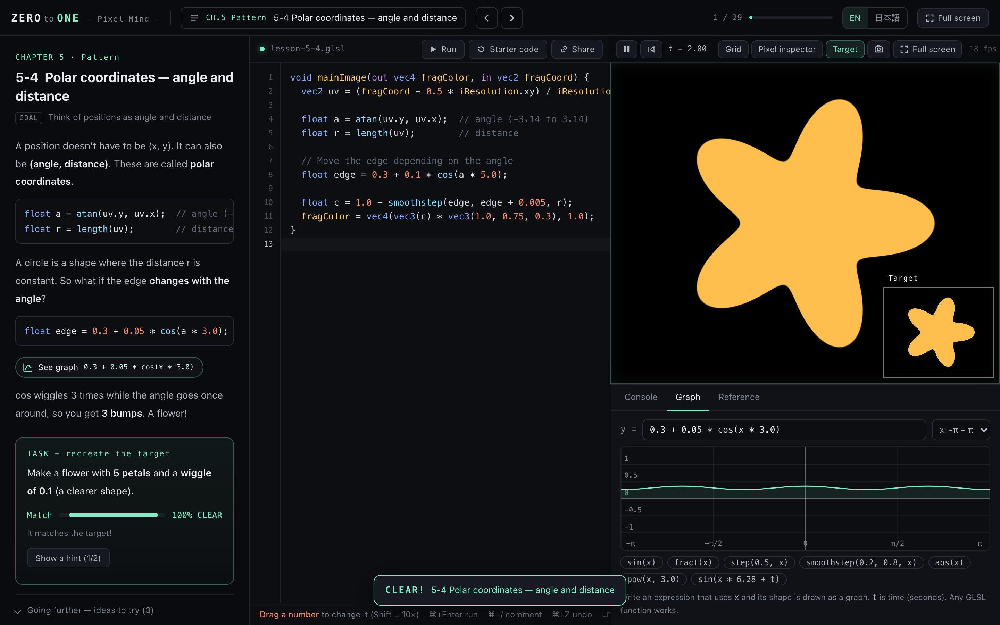
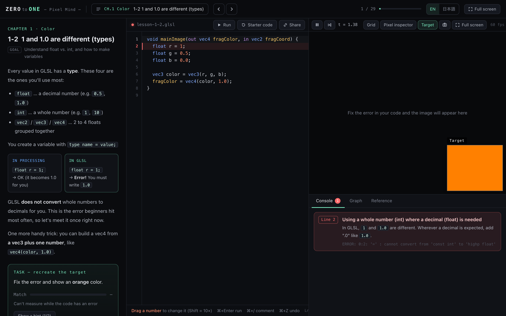
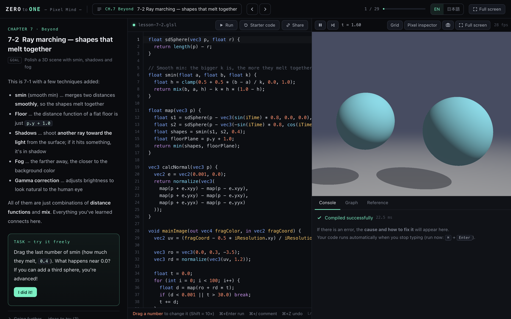

# ZERO to ONE — Pixel Mind —

**Learn GLSL shaders by thinking like a pixel.**
A free, interactive GLSL course that runs in your browser — made for beginners, not engineers.

**[▶ Open the app](https://hugesesame.github.io/zero-to-one-glsl/)** · [日本語の README はこちら](README.ja.md)

## Why this exists

Most GLSL material is written for engineers. If you have only played with something like Processing, it is easy to get lost in the first few pages.

ZERO to ONE starts from the one idea that makes shaders click — **every pixel decides its own color, all at the same time** — and builds up from there in small steps. Nobody gets left behind.

The name comes from how shaders think: colors, positions, almost everything lives **between 0.0 and 1.0**.

## Features

- **29 lessons in 8 chapters**, one new idea per lesson
- **Live coding** — your shader updates as you type
- **Drag any number** in the code to change it, like Processing's Tweak mode
- **Auto-checked tasks** — your output is compared with a target image and shown as a match %
- **Errors explained in plain words** — the cause and how to fix it, with "did you mean…?" suggestions
- **Step-by-step hints**, ending with the answer
- **Pixel inspector** — hover the preview to see a pixel's coordinates and color values
- **Graph tool** — see the shape of `sin`, `step`, `smoothstep`, `fract` and any expression you type
- **Function reference**, coordinate grid, full-screen preview, PNG export
- **Keyboard friendly** — `,` / `.` or `←` / `→` for the previous / next lesson, `Space` to pause, `Cmd/Ctrl+Enter` to run
- **"In Processing / In GLSL"** comparisons throughout
- **Shadertoy-compatible** code (`mainImage`, `iTime`, `iResolution`, `iMouse`), plus a one-click export for TouchDesigner's GLSL TOP
- **English / 日本語** — switch any time
- Progress and code are saved in your browser. No account, no install, no tracking

## Curriculum

| Chapter | Topics |
| --- | --- |
| 0 · Pixel Mind | How a shader draws, reading errors |
| 1 · Color | `vec4`, `1` vs `1.0` (types), `mix` |
| 2 · Coordinates | `fragCoord`, `uv`, moving the origin, `if` |
| 3 · Shapes | `step`, `smoothstep`, circles, aspect ratio, combining shapes, distance functions (SDF) |
| 4 · Motion | `iTime`, waves and ripples, the mouse, rhythm with `fract` |
| 5 · Pattern | Repetition, tile numbers, rotation, polar coordinates |
| 6 · Texture | Cosine palettes, random numbers, noise, fBm |
| 7 · Beyond | Ray marching in 3D, and free creation with examples |

## Screenshots

**A lesson** — task, live preview, target image and the graph tool

**Friendly errors** — what went wrong and how to fix it

**Ray marching** — by Chapter 7 you are building 3D scenes

## Run it locally

The whole app is a single file with no dependencies and no build step.

1. Download [`index.html`](index.html)
2. Open it in your browser

Requires a browser with **WebGL2** (recent Chrome, Edge, Firefox or Safari).

## Credits

- The cosine palette and many distance-function techniques come from [Inigo Quilez](https://iquilezles.org/)'s articles.
- The lesson flow is inspired by [The Book of Shaders](https://thebookofshaders.com/) and the [Shadertoy](https://www.shadertoy.com/) community.

## License

[MIT](LICENSE) © 2026 hugesesame
